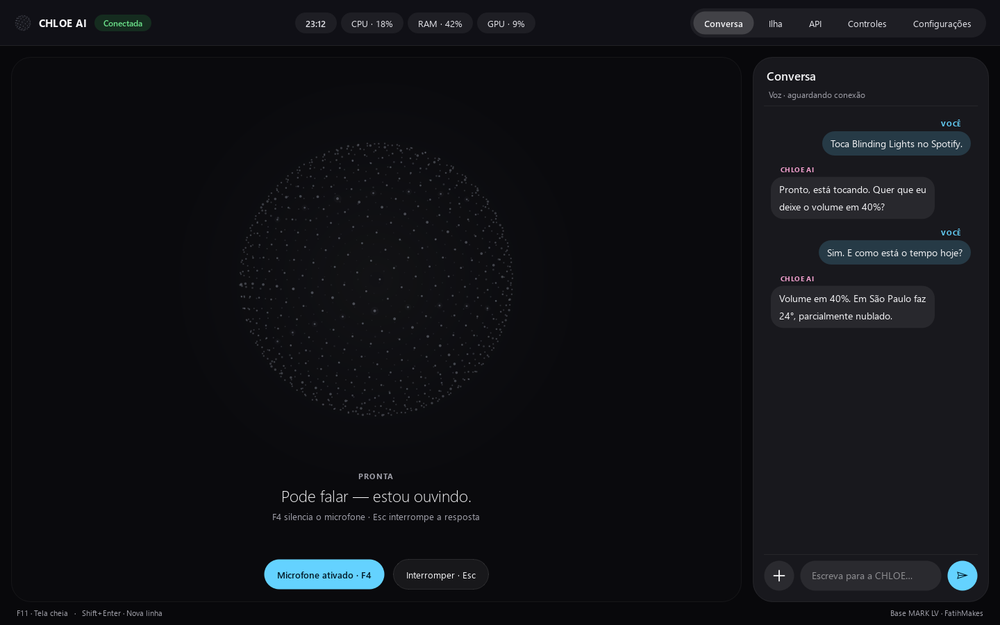
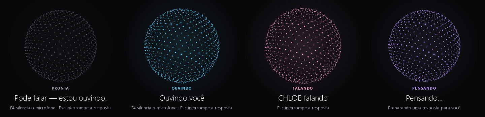
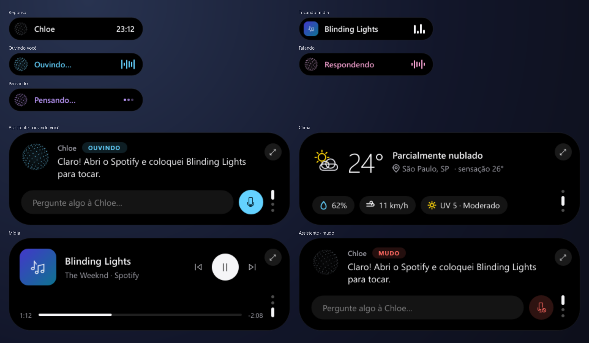

# CHLOE AI

**Assistente pessoal por voz, em português, para o computador.** Você conversa
com a CHLOE como conversaria com uma pessoa: pergunta, pede, interrompe. Ela
responde falando, em tempo real, e faz coisas no seu computador por você.



---

## Para que serve

A ideia é ter um assistente que **fica no seu computador, fala português do
Brasil e resolve sozinho** em vez de te mandar procurar. Pergunte a temperatura
e ela diz os números. Peça para abrir um programa, mexer num arquivo ou baixar o
volume e ela faz. Peça uma explicação e ela explica, de viva voz.

Ela foi pensada para o dia a dia de quem trabalha no computador:

- **Responder perguntas** sem abrir abas: clima de agora e de amanhã, fatos,
  notícias, preços e comparações, com busca na web quando precisa.
- **Agir no computador por voz**: abrir apps e sites, volume, brilho, janelas,
  arquivos e pastas, área de trabalho, lembretes, mensagens, vídeos.
- **Ver o que você vê**: lê a sua tela ou a webcam quando você pede.
- **Lembrar de você**: guarda preferências e contexto entre conversas, e você
  pode ver e apagar tudo o que ela guardou.
- **Ficar à mão sem atrapalhar**: recolhe para a Ilha Dinâmica, uma pílula no
  topo da tela, com resposta, clima e o que estiver tocando.

## Como ela é

A presença da CHLOE é uma **esfera de partículas** que gira devagar e pulsa com
a voz. A cor diz quem está falando:



| Cor | Quando |
|---|---|
| **Cinza** | Em repouso, ninguém falando |
| **Azul** | Você está falando |
| **Rosa** | A CHLOE está falando |
| **Roxo** | Ela está pensando |

### Ilha Dinâmica

Um clique em **Ilha** recolhe a CHLOE para o topo da tela, sempre visível sobre
os outros programas e sem roubar o foco. Passe o mouse para abrir e use a
rodinha para trocar de andar: **Assistente**, **Clima** e **Mídia** (Spotify,
YouTube, VLC…).



## O que ela sabe fazer

| Área | Exemplos do que pedir |
|---|---|
| Conversa | Perguntas, explicações, ideias — em voz, com resposta imediata |
| Clima | "Qual a temperatura agora?", "Vai chover amanhã no Rio?" |
| Web | Buscar, ver notícias, pesquisar a fundo, preço de um produto, comparar opções |
| Computador | Abrir programas e sites, volume, brilho, janelas, atalhos, modo escuro |
| Arquivos | Encontrar, mover, renomear, criar, ler e resumir arquivos |
| Tela e câmera | "O que tem na minha tela?", "Olha pela câmera" |
| Lembretes | "Me lembra amanhã às 9h de ligar para o banco" |
| Mídia | Tocar vídeos no próprio painel, controlar o player do Windows |
| Memória | Lembrar preferências; mostrar e apagar o que foi guardado |
| Programação | Ajuda com código e criação de projetos completos |

Ações que não têm volta (desligar, reiniciar, desligar o Wi-Fi) só acontecem
depois que **você** confirma num botão na tela. O que ela muda em arquivos e
configurações pode ser desfeito ("desfaz isso").

## Privacidade

- A sua chave do Gemini fica **só no seu computador**, em `config/api_keys.json`,
  que nunca vai para o Git.
- A memória pessoal fica em `memory/`, também fora do Git, e pode ser vista e
  apagada pela própria interface.
- Os registros de diagnóstico (`logs/`) guardam códigos e números, nunca o que
  você ou a CHLOE disseram.
- Microfone: enquanto a CHLOE fala, o microfone não é enviado; com **F4** ele
  fica desligado de verdade. Há também palavra de ativação e "segurar para
  falar", opcionais.

## Instalação (Windows)

Requisitos: **Windows 10 ou 11**, **Python 3.11 a 3.13** (3.13 recomendado),
microfone e alto-falante, e uma **chave gratuita da API Gemini**
([Google AI Studio](https://aistudio.google.com/apikey)).

```powershell
git clone https://github.com/Drn66/chloe-ai.git
cd chloe-ai
py -3.13 -m venv .venv
.\.venv\Scripts\python.exe setup.py
.\.venv\Scripts\python.exe -B main.py
```

Na primeira abertura, clique em **API** e cole a sua chave. Em **Configurações →
Criar atalho na área de trabalho** você ganha o atalho **CHLOE AI**, que abre o
app sem terminal. Detalhes de instalação, áudio e solução de problemas estão em
[CHLOE.md](CHLOE.md).

## Atalhos

| Tecla | O que faz |
|---|---|
| **F4** | Liga/desliga o microfone |
| **Esc** | Interrompe a fala da CHLOE |
| **F11** | Tela cheia |
| **Shift+Enter** | Nova linha na mensagem escrita |
| **Ctrl+Space** | Segurar para falar (quando ativado) |

## Como funciona por dentro

- **Voz em tempo real** com a Gemini Live API: o áudio vai e volta em streaming,
  então ela começa a responder enquanto ainda está pensando.
- **Ferramentas descobertas sozinhas**: cada habilidade é um arquivo em
  `actions/` com a sua descrição; para criar uma nova, basta um arquivo
  (veja `plugins/_template.py`).
- **Interface em PyQt6**, desenhada sem GPU: esfera de partículas, Ilha
  Dinâmica e conversa em balões.
- **Clima pela Open-Meteo**, gratuita e sem chave; a cidade é estimada pelo IP
  quando você não diz qual.

```
main.py              sessão de voz, ferramentas e áudio
ui.py                janela completa
frontend/            esfera, Ilha Dinâmica, conversa, tema
actions/             habilidades (clima, busca, arquivos, apps…)
core/                serviços (clima, mídia, memória, eco, prompt)
launch_chloe.py      inicializador do atalho do Windows
tests/               testes automáticos (sem rede nem credenciais)
```

Para rodar os testes:

```powershell
$env:QT_QPA_PLATFORM = "offscreen"
.\.venv\Scripts\python.exe -B -m unittest discover -s tests -p "test_*.py"
```

## Créditos e licença

A CHLOE AI deriva do **MARK LV**, de [FatihMakes](https://www.youtube.com/@FatihMakes),
adaptado para português, com novo visual, Ilha Dinâmica e outras melhorias. O
README original está preservado em [docs/README-MARK-LV.md](docs/README-MARK-LV.md).

Distribuída sob a licença **Creative Commons Atribuição-NãoComercial 4.0
(CC BY-NC 4.0)** — veja [LICENSE](LICENSE). **Uso comercial não é permitido.**
